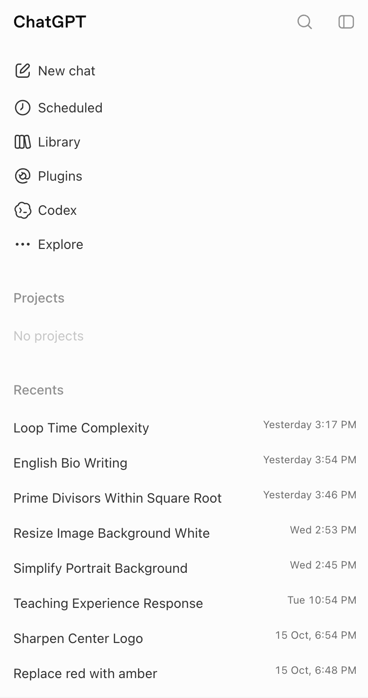
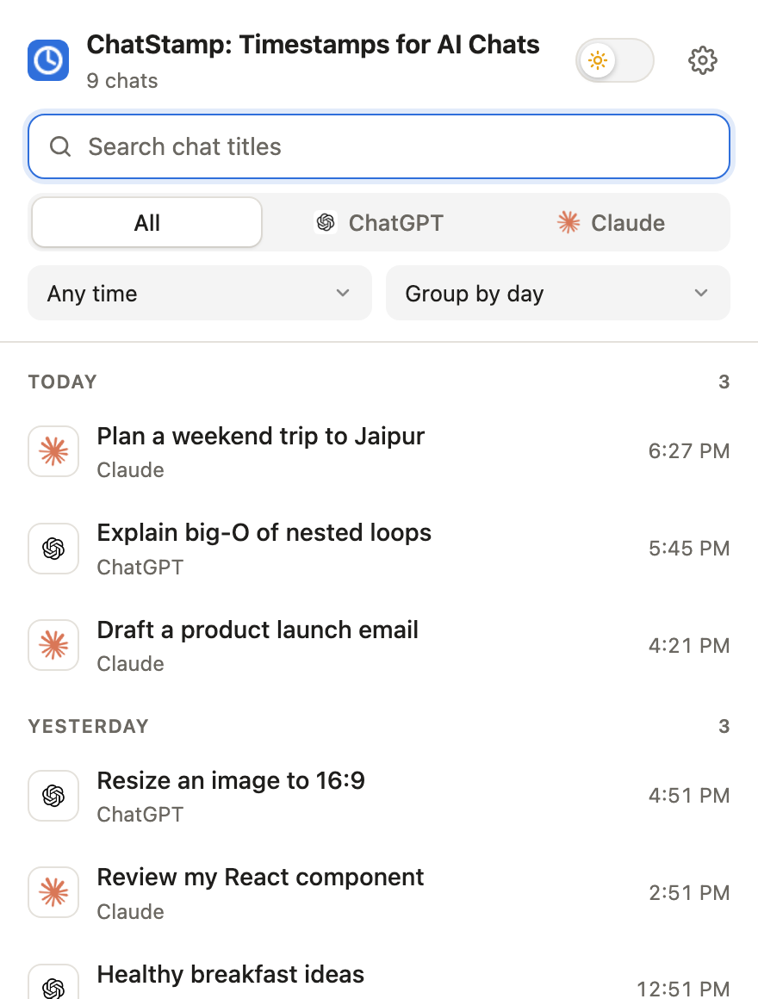
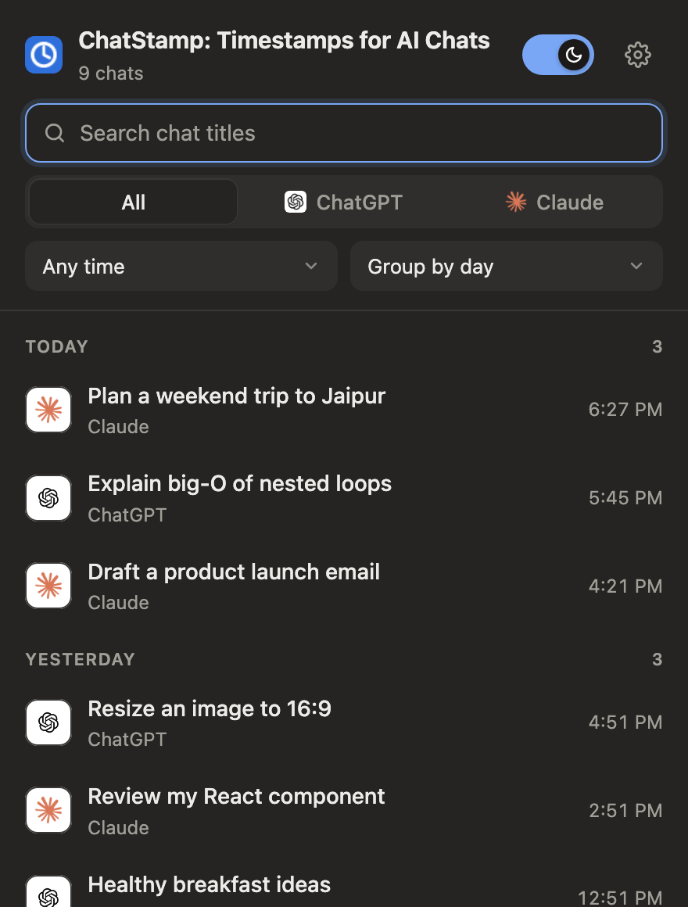
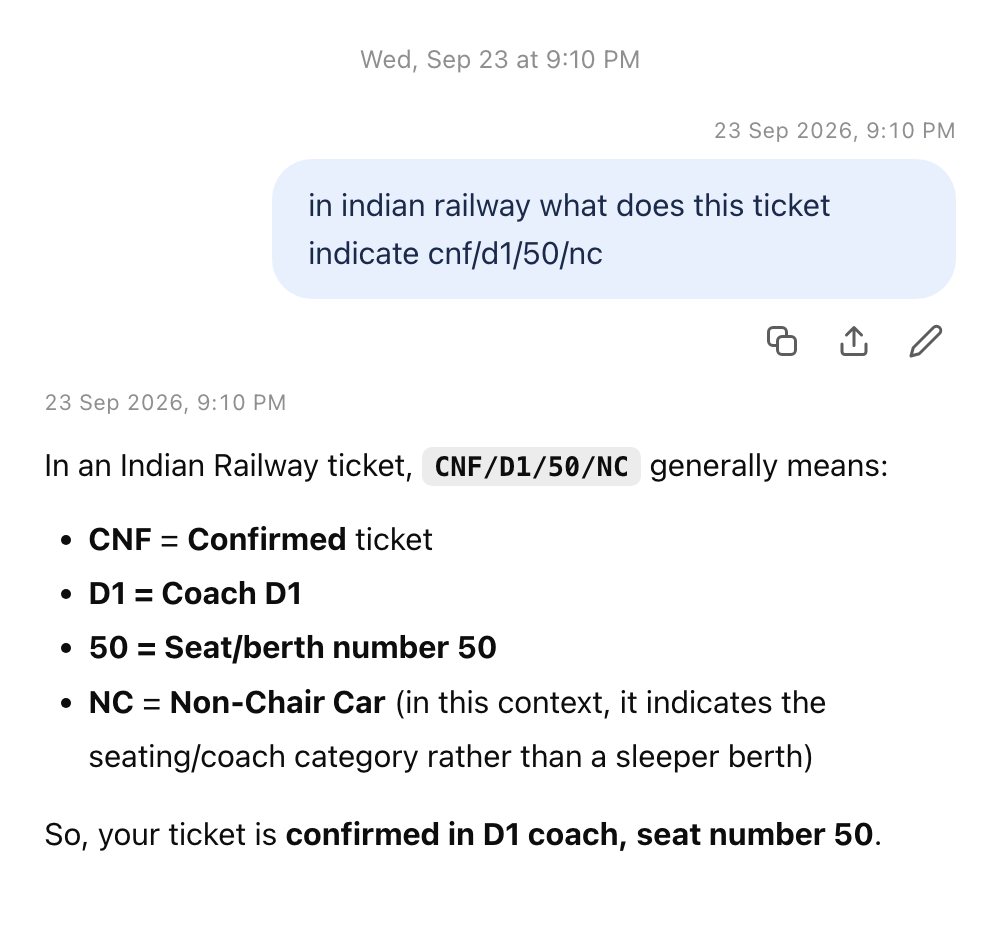
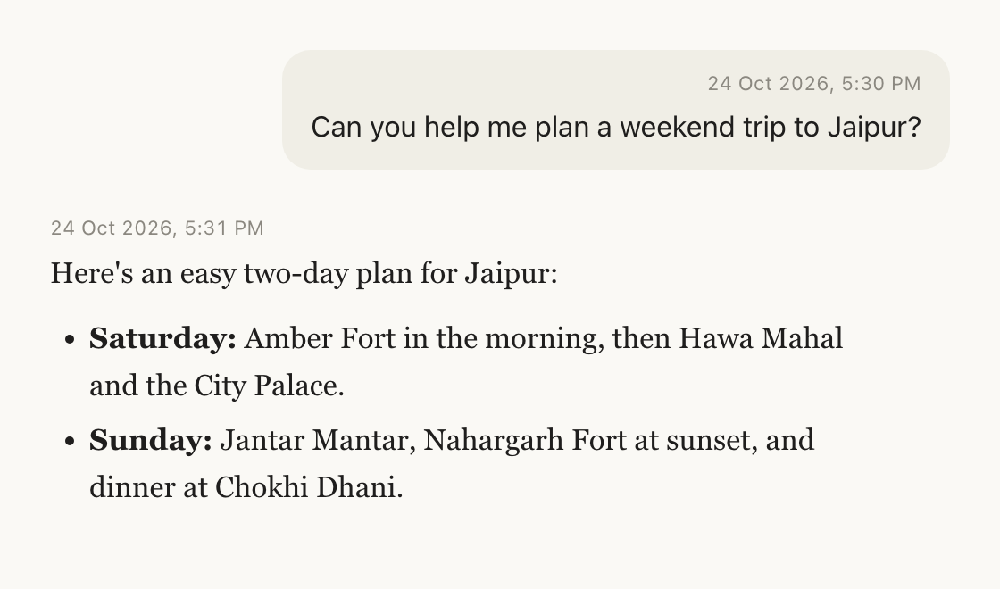

# ChatStamp: Timestamps for AI Chats

> **Chrome Extension** for ChatGPT and Claude · Manifest V3 · No build step · All data stays on your device

A Chrome extension (Manifest V3) that shows when each chat started in the ChatGPT and Claude sidebars, puts a date and time on every message, and lets you search your chats by title, site and date. No server, no account: all data stays in `chrome.storage.local`.

## Screenshots

### Chat start times in the sidebar

Every chat in the sidebar shows when it started: the time for today, "Yesterday" or the weekday for this week, and the date for older chats. Hover a label for the full date and time.



### Search popup

Click the toolbar icon to search chat titles across both sites, filter by site and date range, and group by day or month. Light mode is the default; the switch in the header turns on dark mode.

<p>
  
  
</p>

### Message times in ChatGPT

Each message gets its date and time just above it: on the right for your messages, on the left for replies.



### Message times in Claude

Your messages show the time on the right at the top of the bubble; Claude's replies show it on the left.



## Load it

1. Open `chrome://extensions` and turn on **Developer mode**.
2. Click **Load unpacked** and choose this folder.
3. Reload any open chatgpt.com or claude.ai tabs.

There is no build step. After changing code, click the reload icon on the extension's card, then reload the site tab.

Development (unpacked) installs log adapter failures to the console with the prefix `[ChatStamp]`; store builds do not.

## Tests

```sh
node --test
```

Covers date formatting, the storage merge rules, search, grouping and export/import. Selectors and endpoints can only be checked against the live sites (see the QA checklist below).

## How it works

| Part | File | Job |
| --- | --- | --- |
| Platform adapters | `src/platforms/*.js` | Selectors, chat-ID patterns and metadata endpoints, one file per site (FR-1, FR-2) |
| Collector | `src/content/collector.js` | Records first-seen times; pulls real creation times from the site's own chat list (FR-3, FR-4) |
| Message stamper | `src/content/messages.js` | Date and time above each message, right for yours and left for replies in the open chat; matched by message id (ChatGPT) or by position per role (Claude) |
| Injector | `src/content/injector.js` | Adds a label beside each sidebar chat and keeps it there as the sidebar re-renders (FR-5, FR-7, FR-8) |
| Navigation watcher | `src/content/navigation.js` | Catches in-app route changes so new chats are recorded (FR-6) |
| Entry point | `src/content/main.js` | Picks the adapter, wires everything up, MutationObserver with 150 ms debounce |
| Popup | `src/pages/popup.*` | Toolbar popup: search titles across sites, filter by site and date range (FR-10), group by day or month (FR-11) |
| Search logic | `src/shared/search.js` | Filtering, grouping, chat URLs, JSON export/import parsing |
| Settings | `src/pages/options.*` | Date format, clock, per-site toggles (FR-9), JSON export and import (FR-12), clear all data (FR-13) |
| Welcome page | `src/pages/welcome.html` | Opens once after install |

Stored record, one key per chat (`c:<platform>:<chatId>`):

```js
{ p: 'chatgpt', id: '…', t: 'Title', c: createdAtMs, u: updatedAtMs, f: firstSeenMs }
```

`c` is the real creation time. When it is missing, the label shows `f` with a `~` prefix and an "Estimated" tooltip. `f` only ever moves earlier.

### Date sources

| Site | Source | Notes |
| --- | --- | --- |
| ChatGPT | `/api/auth/session` → `/backend-api/conversations` (paged, 100 per page, stops at the first page with nothing new) | Undocumented; falls back to first-seen |
| Claude | `/api/organizations` → `/api/organizations/<org>/chat_conversations` | Undocumented; falls back to first-seen |

Requests go only to the site already open, with the user's existing session, once per page load and again only after navigating to a chat that has no real date yet (throttled to one per 15 s).

## When a site changes

Labels disappearing usually means a selector broke. Fix it in that site's file in `src/platforms/`:

- `linkSelectors`: tried in order; the first one that matches anything is used. The last entry is a broad URL-pattern fallback.
- `titleSelector`: the label is inserted right after this element inside each link. If it isn't found, the label is appended to the link.
- `fetchMetadata`: endpoint and field names.

## QA checklist

- [ ] ChatGPT: old chats show real dates (no `~`) within a second of the sidebar loading
- [ ] ChatGPT: start a new chat; a date appears without reloading
- [ ] Claude: same two checks
- [ ] Hover shows full date and time, plus "Updated …" when available
- [ ] Scrolling a long sidebar keeps labels on newly loaded chats
- [ ] Labels are readable in light and dark themes
- [ ] Settings: format and clock changes update open tabs live; turning a site off removes its labels
- [ ] Popup: search matches titles across sites; site, date-range and custom from/to filters work; clicking a result opens the chat
- [ ] Popup: grouping by day/month/none works and is remembered
- [ ] Export downloads a JSON file; importing it into a fresh profile restores the dates
- [ ] Open a chat: every message shows its date and time (AM/PM by default); hover shows seconds
- [ ] Send a new message: its time appears within about 10 seconds
- [ ] Settings: unticking "Show date and time on each message" removes them
- [ ] Clear all data removes every label
- [ ] Block the metadata endpoint in DevTools (Network → Block request URL); the site still works and opened chats get `~` dates

## Not built yet (from the PRD)

- Store listing assets and screenshots.

Gemini support was removed in 0.3.0: Gemini exposes no creation times, so it could only show first-seen estimates for chats opened after install.

The v1.1 popup is plain JavaScript rather than React, so the extension still has no build step.

See `PRIVACY.md` for the privacy policy.
