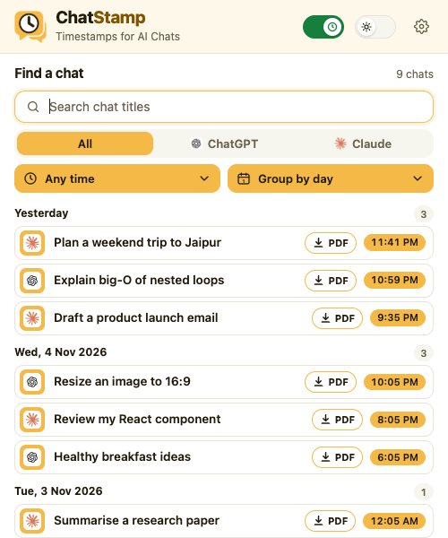
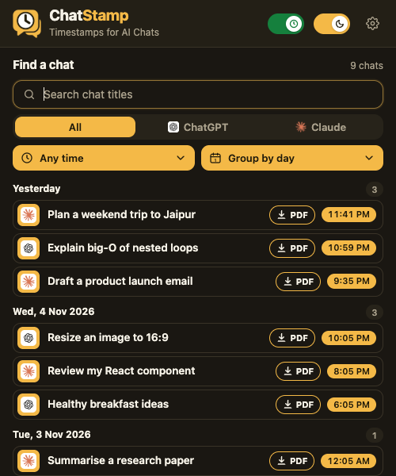
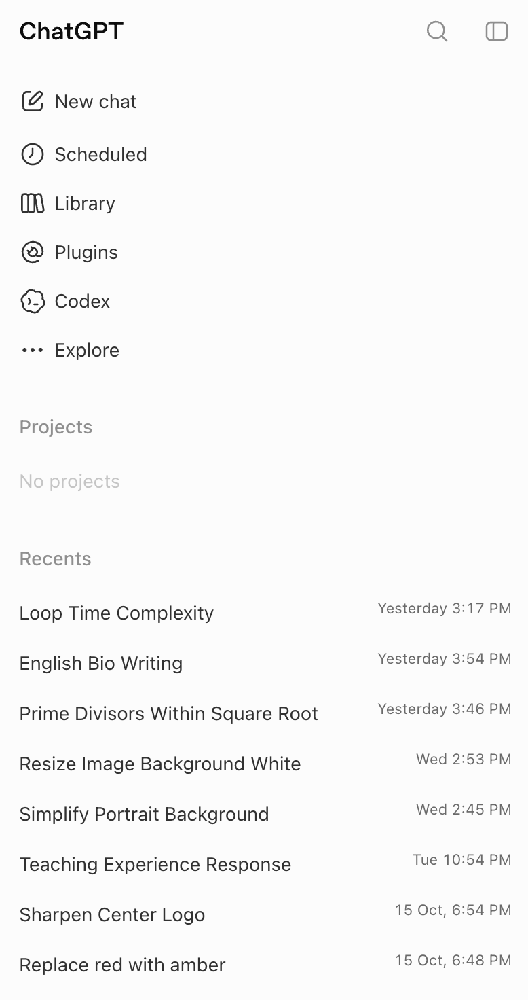
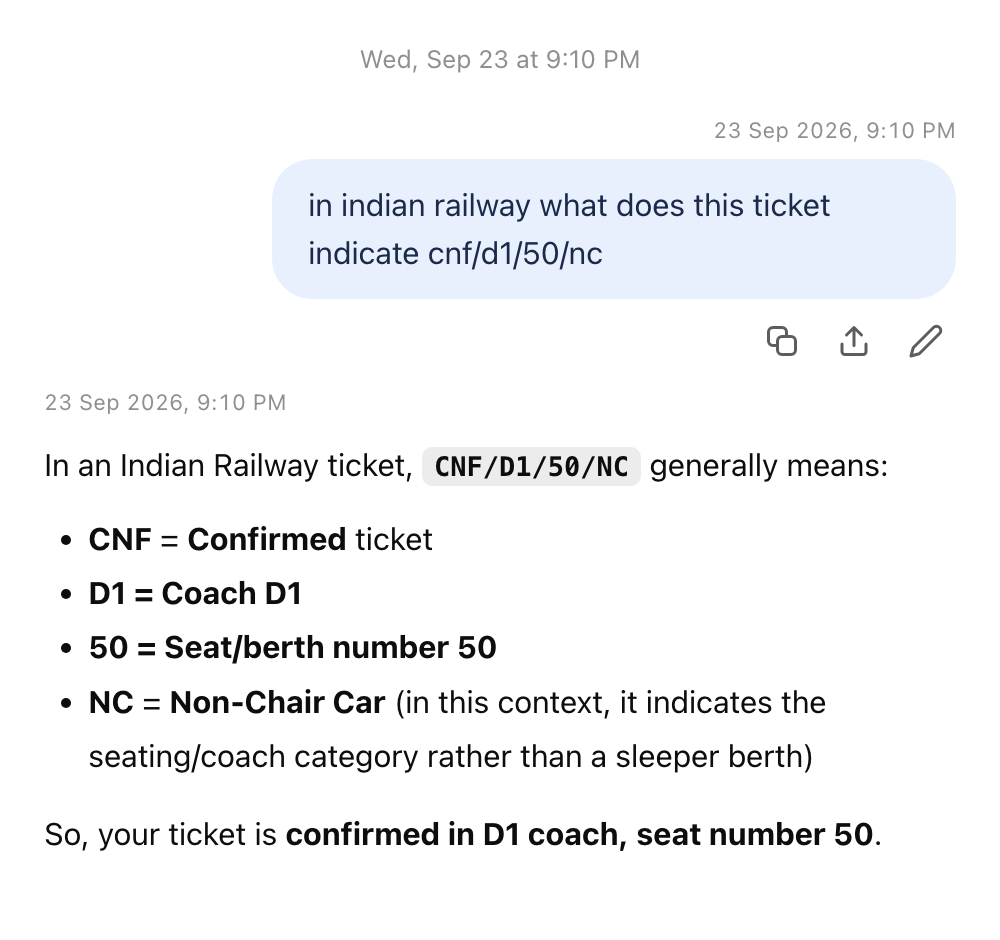
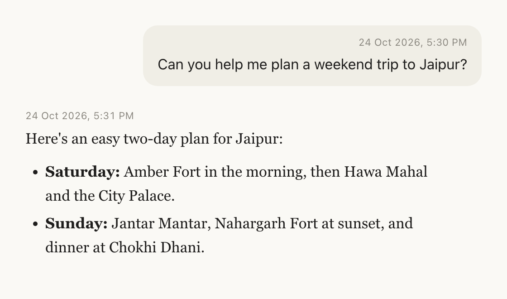
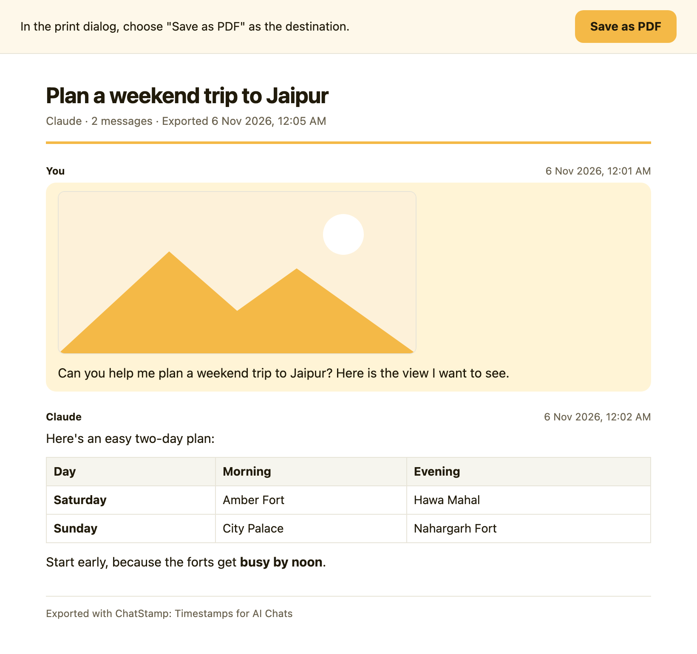
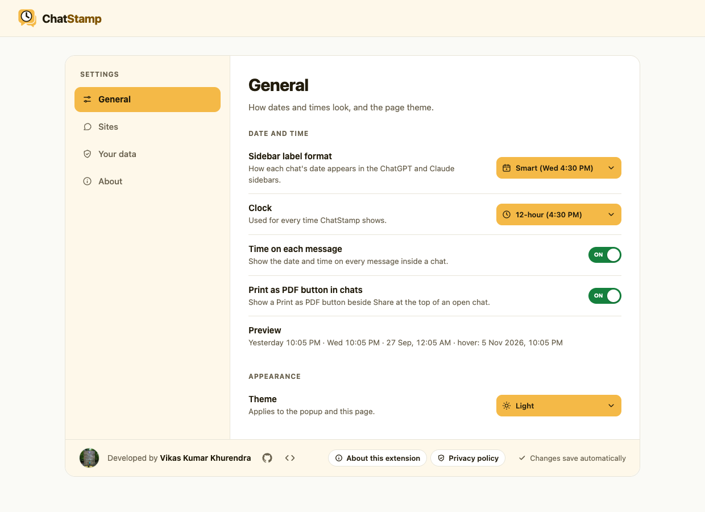

# ChatStamp: Timestamps for AI Chats

> **Chrome Extension** for ChatGPT and Claude · Manifest V3 · No build step · All data stays on your device

A Chrome extension (Manifest V3) that adds the missing dates and times to ChatGPT and Claude, lets you search your chats, and prints any chat as a PDF. No server, no account: chat dates stay in `chrome.storage.local`, and message text is never stored.

## Features

- **Dates in the sidebar:** every chat shows when it started, including chats from before you installed the extension.
- **A time on every message:** the date and time appear above each message inside a chat.
- **Search popup:** find a chat by title, site or date range, grouped by day or month.
- **Print as PDF:** save a clean copy of a chat, with its formatting, times and images, from a button beside Share or from the popup.
- **Your controls:** one switch to turn all timestamps off, light and dark themes, 12- or 24-hour clock, per-site switches, and JSON export and import.

## Screenshots

### Search popup

Click the toolbar icon to search chat titles across both sites, filter by site and date range, and group by day or month. Each row has a PDF button. Two switches sit in the header: one turns all timestamps on the chat sites on or off (green is on, red is off), the other switches between light and dark mode (light is the default).

<p>
  
  
</p>

### Chat start times in the sidebar

Every chat in the sidebar shows when it started: the time for today, "Yesterday" or the weekday for this week, and the date for older chats. Hover a label for the full date and time.



### Message times in ChatGPT

Each message gets its date and time just above it: on the right for your messages, on the left for replies.



### Message times in Claude

Your messages show the time on the right at the top of the bubble; Claude's replies show it on the left.



### Print a chat as PDF

Click **Print as PDF** beside Share in a chat, or **PDF** in the popup. The chat opens as a clean document and Chrome's print dialog appears: choose **Save as PDF**. The chat's title becomes the suggested file name.



Images that can't be fetched show as `[Image]`. A PDF includes up to 40 images, each up to 8 MB, and leaves out tool calls, the AI's hidden reasoning and older versions of edited messages.

### Settings



## Load it

1. Open `chrome://extensions` and turn on **Developer mode**.
2. Click **Load unpacked** and choose this folder.
3. Reload any open chatgpt.com or claude.ai tabs.

There is no build step. After changing code, click the reload icon on the extension's card, then reload the site tab.

Development (unpacked) installs log adapter failures to the console with the prefix `[ChatStamp]`; store builds do not.

## Tests

```sh
node --test
```

Covers date formatting, the storage merge rules, search, grouping, export/import, Markdown rendering and escaping, reading chats for PDF export, and extension-page rules (no inline scripts, no broken local links). Selectors and endpoints can only be checked against the live sites (see the QA checklist below).

## How it works

| Part | File | Job |
| --- | --- | --- |
| Platform adapters | `src/platforms/*.js` | Selectors, chat-ID patterns and metadata endpoints, one file per site (FR-1, FR-2) |
| Collector | `src/content/collector.js` | Records first-seen times; pulls real creation times from the site's own chat list (FR-3, FR-4) |
| Message stamper | `src/content/messages.js` | Date and time above each message, right for yours and left for replies in the open chat; matched by message id (ChatGPT) or by position per role (Claude) |
| Print page | `src/pages/print.*`, `src/shared/markdown.js` | Shows a chat as a clean document for Chrome's Save as PDF; message text stays in that tab's memory |
| PDF button | `src/content/pdfbutton.js` | Adds a Print as PDF button beside the site's Share button; `src/background.js` opens the print page |
| Injector | `src/content/injector.js` | Adds a label beside each sidebar chat and keeps it there as the sidebar re-renders (FR-5, FR-7, FR-8) |
| Navigation watcher | `src/content/navigation.js` | Catches in-app route changes so new chats are recorded (FR-6) |
| Entry point | `src/content/main.js` | Picks the adapter, wires everything up, MutationObserver with 150 ms debounce |
| Popup | `src/pages/popup.*` | Toolbar popup: search titles across sites, filter by site and date range (FR-10), group by day or month (FR-11) |
| Search logic | `src/shared/search.js` | Filtering, grouping, chat URLs, JSON export/import parsing |
| Menus | `src/pages/dropdown.js` | Styled menus with icons for the popup and Settings, backed by hidden `<select>`s |
| Settings | `src/pages/options.*` | Date format, clock, theme, message times, PDF button, per-site toggles (FR-9), JSON export and import (FR-12), clear all data (FR-13) |
| Welcome page | `src/pages/welcome.html` | Opens once after install |
| Privacy page | `src/pages/privacy.*` | Shows `PRIVACY.md` inside the extension |

Stored record, one key per chat (`c:<platform>:<chatId>`):

```js
{ p: 'chatgpt', id: '…', t: 'Title', c: createdAtMs, u: updatedAtMs, f: firstSeenMs }
```

`c` is the real creation time. When it is missing, the label shows `f` with a `~` prefix and an "Estimated" tooltip. `f` only ever moves earlier.

### Date sources

| Site | Source | Notes |
| --- | --- | --- |
| ChatGPT | `/api/auth/session` → `/backend-api/conversations` (paged, 100 per page, stops at the first page with nothing new) | Undocumented; falls back to first-seen |
| Claude | `/api/organizations` → `/api/organizations/<org>/chat_conversations` | Undocumented; falls back to first-seen |

Requests go only to the site already open, with the user's existing session, once per page load and again only after navigating to a chat that has no real date yet (throttled to one per 15 s).

## When a site changes

Labels disappearing usually means a selector broke. Fix it in that site's file in `src/platforms/`:

- `linkSelectors`: tried in order; the first one that matches anything is used. The last entry is a broad URL-pattern fallback.
- `titleSelector`: the label is inserted right after this element inside each link. If it isn't found, the label is appended to the link.
- `fetchMetadata`: endpoint and field names.
- `messageElements`: how messages are found in the page, for message times.
- `fetchMessageTimes`, `fetchConversation`: chat and image endpoints. These are undocumented too.
- `shareButtonSelectors`: where the Print as PDF button goes. If none match, it looks for a button named "Share" near the top of the page.

ChatGPT replies can contain layout tags like `<box>` and `<Entity>`. If they appear in a PDF, the cleanup is `stripChatUiTags` in `src/shared/markdown.js`.

## QA checklist

- [ ] ChatGPT: old chats show real dates (no `~`) within a second of the sidebar loading
- [ ] ChatGPT: start a new chat; a date appears without reloading
- [ ] Claude: same two checks
- [ ] Hover shows full date and time, plus "Updated …" when available
- [ ] Scrolling a long sidebar keeps labels on newly loaded chats
- [ ] Labels are readable in light and dark themes
- [ ] Settings: format and clock changes update open tabs live; turning a site off removes its labels
- [ ] Popup: search matches titles across sites; site, date-range and custom from/to filters work; clicking a result opens the chat
- [ ] Popup: grouping by day/month/none works and is remembered
- [ ] Popup menus: mouse, arrow keys, Enter, Escape and clicking outside all work; Escape closes only the menu
- [ ] Export downloads a JSON file; importing it into a fresh profile restores the dates
- [ ] Open a chat: every message shows its date and time (AM/PM by default); hover shows seconds
- [ ] Send a new message: its time appears within about 10 seconds
- [ ] Settings: turning off "Time on each message" removes them
- [ ] Popup timestamps switch: off removes sidebar and message labels from open tabs without a reload, on brings them back; the popup still lists chats and says "timestamps off"
- [ ] Popup PDF button: opens a formatted copy of the chat and the print dialog, with the chat's title as the file name; works with no site tab open, and shows a clear message when signed out
- [ ] PDF of a chat with uploaded images on ChatGPT and Claude: images appear; one that can't load shows [Image]
- [ ] Print as PDF button beside Share on ChatGPT and Claude: opens the print page for that chat, returns after the header redraws, is absent on non-chat pages, and hides with its Settings switch
- [ ] Settings: About this extension and Privacy policy open from the footer, and the policy text loads
- [ ] Clear all data removes every label
- [ ] Block the metadata endpoint in DevTools (Network → Block request URL); the site still works and opened chats get `~` dates

See [`PRIVACY.md`](PRIVACY.md) for the privacy policy.
